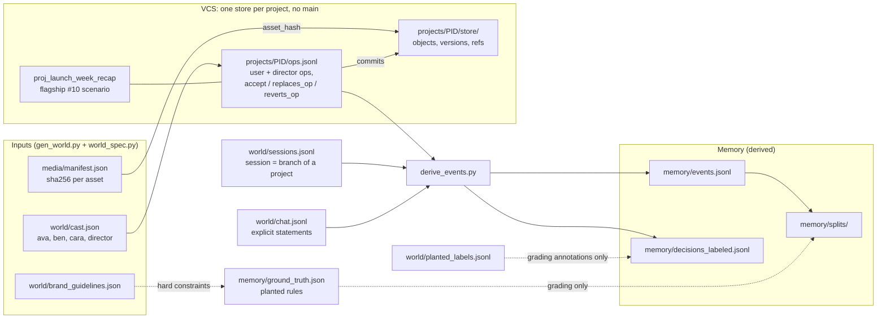

# Data (all synthetic)

> **Everything in `data/` is synthetic.** The scripts in `generators/` generate it from fixed seeds. The style-memory signal contains **planted rules**, which are listed in `memory/ground_truth.json`. Any accuracy number computed here tells you how well a system recovers that planted structure, not how well it models real creators.

To regenerate and validate everything, run `make data` (or `scripts/generate_all.sh`). On a given machine, two runs produce byte-identical output. A different ffmpeg build or font set can produce different media bytes. If that happens, the hashes change too, and those flow through every snapshot.

## How the data connects

There's one world: one cast, one team, one brand, and one input stream.

- **Cast.** `ava` and `ben` are creators. `cara` leads the `team_northwind` team, and all three are members. The team works under the `northwind` brand, defined in `world/brand_guidelines.json`. `director` is the editing agent, and it always acts `on_behalf_of` the person in the session.
- **Projects and sessions.** There are 36 projects. Each one has its own content-addressed store and its own branches, and none has a main branch. A **session** is the set of commits on one branch of one project.
- **Every edit is a VCS op.** That covers edits by people and edits by the Director. The user's reaction to a Director edit is also an op: `accept`, an override with `replaces_op`, or a `revert` with `reverts_op`. Chat statements go to a separate log, `world/chat.jsonl`.
- **Memory is derived, never generated.** `generators/derive_events.py` reads the op logs and the chat log and writes `memory/events.jsonl`, `memory/decisions_labeled.jsonl` and `memory/splits/`. Each event points back to its source, either an `op_id` (plus the `version_id` it produced) or a `chat_id`.
- **The flagship #10 scenario is part of this world.** `proj_launch_week_recap` is a team project in which ava, cara and ben branch, trim, add text and conflict. Its categorised ops show up as `user_edit` memory events, in split `flagship`.

Reading an override in this setup works like this:
1. The Director op `add_transition` (author `director`, on behalf of `ava`) lands in a Director commit on branch `ava/cut-04`.
2. In the review commit that follows, ava's `change_transition` with `replaces_op` pointing at that op becomes a `user_override` event, with `replaced_action` set to the Director's choice.
3. The decision's `final_action` is ava's choice.

## File by file

| path | what it is | written by | read by |
|---|---|---|---|
| `media/files/*` | 11 tiny test assets (640x360, 30 fps, about 1.4 MB total) with burned-in labels and timecode; sine-tone audio | `gen_media.py` | renders (later), `validate.py` |
| `media/manifest.json` | asset id, kind, role, path, **sha256**, duration | `gen_media.py` | `gen_world.py`, `validate.py`, renderer |
| `world/cast.json` | people, the agent, the team, subjects | `gen_world.py` (from `world_spec.py`) | both demos |
| `world/brand_guidelines.json` | Northwind hard constraints (fonts, banned transitions/effects/music, caption + logo rules), palette, soft defaults | `gen_world.py` | memory service (hard filter), `validate.py` |
| `world/vocab.json` | context keys and values, actions per category, cut-length buckets, event types | `gen_world.py` | memory service, `validate.py` |
| `world/sessions.jsonl` | 106 sessions: subject, actor, project, **branch**, scope, brand, format, split | `gen_world.py` | `derive_events.py`, both demos |
| `world/chat.jsonl` | 15 chat messages (explicit statements and some chatter), each tied to a session, project and branch | `gen_world.py` | `derive_events.py` |
| `world/planted_labels.jsonl` | per decision: the planted rule that generated it, and the intended user action. **Generator-only; never memory input** | `gen_world.py` | `derive_events.py` (annotates `decisions_labeled` only), `validate.py` |
| `vcs/timeline.schema.json`, `vcs/schema.md` | timeline model, store layout, op log, review ops, conflict rule | hand-written | everyone |
| `vcs/projects/index.json` | the 36 projects with owner, scope, brand, sessions, counts | `gen_world.py` | both demos, `derive_events.py` |
| `vcs/projects/<pid>/project.json` | owner subject, scope, brand, and per-section footage and cut type | `gen_world.py` | `derive_events.py`, VCS demo |
| `vcs/projects/<pid>/ops.jsonl` | **the shared input stream**: every op in the project | `gen_world.py` / `flagship.py` | VCS demo (diff, blame, pull), `derive_events.py` |
| `vcs/projects/<pid>/store/objects/` | timeline snapshots as canonical JSON, named by sha256 | same | VCS demo, renderer |
| `vcs/projects/<pid>/store/versions/`, `refs.json` | immutable version objects and branch refs (no main) | same | VCS demo |
| `vcs/projects/proj_launch_week_recap/scenario.json` | flagship story, edit types, **expected selective-pull results** | `flagship.py` | VCS demo tests |
| `.../proj_launch_week_recap/{base_timeline.json, heads/, expected/}` | flagship base, branch heads, expected clean-pull timelines | `flagship.py` | VCS demo, renders |
| `memory/events.jsonl` | 4,267 derived events, each tracing to an `op_id`/`version_id` or a `chat_id` | `derive_events.py` | memory service |
| `memory/decisions_labeled.jsonl` | 1,995 decisions: context, agent_action, final_action, event and op ids, planted rule. **For grading** | `derive_events.py` | evaluation |
| `memory/splits/events_{train,heldout,flagship}.jsonl` | partition of the events: held-out = last 6 generated sessions per subject; flagship = the scripted #10 project | `derive_events.py` | memory service, evaluation |
| `memory/splits/decisions_heldout.jsonl` | held-out decisions without planted labels; `final_action` is the label | `derive_events.py` | evaluation |
| `memory/ground_truth.json` | planted rules, drift, conflicts, brand violations (by `op_id`), statements, noise, split definitions | `gen_world.py` | evaluation, demo narration |

## Counts (from `make validate`)
- **Projects:** 36. Owners and scopes:
  - team_northwind: 12, including the flagship.
  - ava: 6 private, 6 brand/team.
  - ben: 7 private, 5 brand/team.
- **Store:** 970 versions, 924 unique snapshots, 142 branches.
- **Ops:** 4,320 in total:
  - Director: 1,989.
  - Users: ava 867, ben 1,029, cara 435.
  - Review markers: 1,020 `accept` and 268 `revert`.
- **Sessions:** 106 in total. 102 are generated (ava 36, ben 34, team 32, spread over June to October 2026 IST) and 4 are flagship sessions.
- **Events:** 4,267 derived:
  - `agent_edit`: 1,989
  - `user_accept`: 1,020
  - `user_override`: 969
  - `undo`: 268
  - `user_edit`: 6 (flagship)
  - `explicit_statement`: 15
  - In addition, 68 ops have no preference category (format changes and the flagship's move, split, delete, volume and text-copy ops), so they produce no event.
- **Splits:** train 3,525 events, held-out 736 events (350 decisions), flagship 6 events.

## Planted structure (the full list is in `memory/ground_truth.json`)
- **Context-dependent preferences.** Example: ava uses warm_film on talking-head footage and teal_orange on B-roll. Her captions are word_pop on 9:16 and minimal_modern elsewhere. Her cuts are short, medium and long for the hook, body and outro.
- **Drift (ava).** On talking-head footage after a jump cut, she uses `crossfade` in sessions 1 to 17 and `whip_pan` from session 18, with a 3-session ramp at 65%. She also says so in chat in session 21. As a control, her B-roll transitions **stay** `crossfade`.
- **Team vs private (ben, 9:16 captions).** ben uses `beast_mode` privately. The team standard is `stacked`; cara says so in chat in team sessions 1 and 20, and ben argues against it in team session 19. In team-scope projects, ben uses stacked about 70% of the time and beast_mode about 30%.
- **Brand vs private (ben).** ben's private font is Bebas Neue, which the brand doesn't allow. He uses it in brand projects twice.
- **Brand-violating attempts.** There are 6, each referenced by `op_id`. The Director proposes glitch (twice), Comic Sans MS and dramatic_horror music in brand projects, and each time the user overrides it. The other two are ben's uses of Bebas Neue.
- **Noise.** Each rule's `strength` is between 0.7 and 0.92. In 30% of cases the Director happens to propose the preferred action. About 3% of accepted edits are later undone without a replacement.
- **Fixed per project.** Section footage type and cut type are properties of the imported footage, so they're the same for every session in a project. Format is set per session with a `set_format` op.

`validate.py` prints descriptive counts for the drift, control and conflict slices. These are counts of the generated data, not model results.
