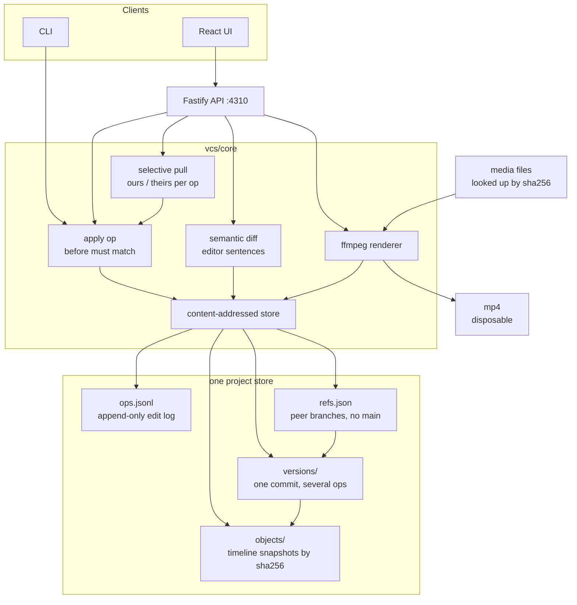
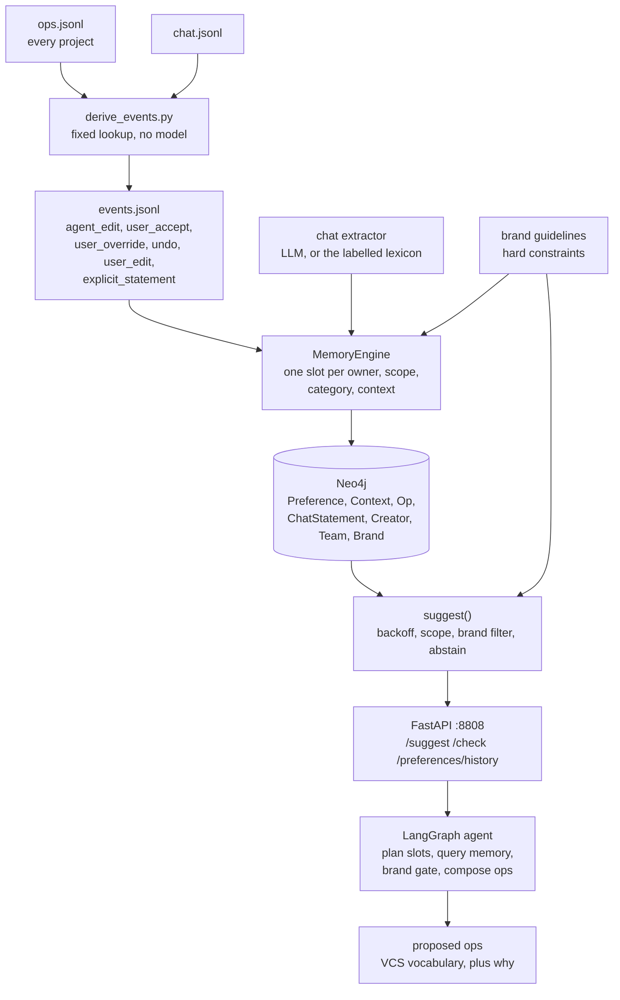
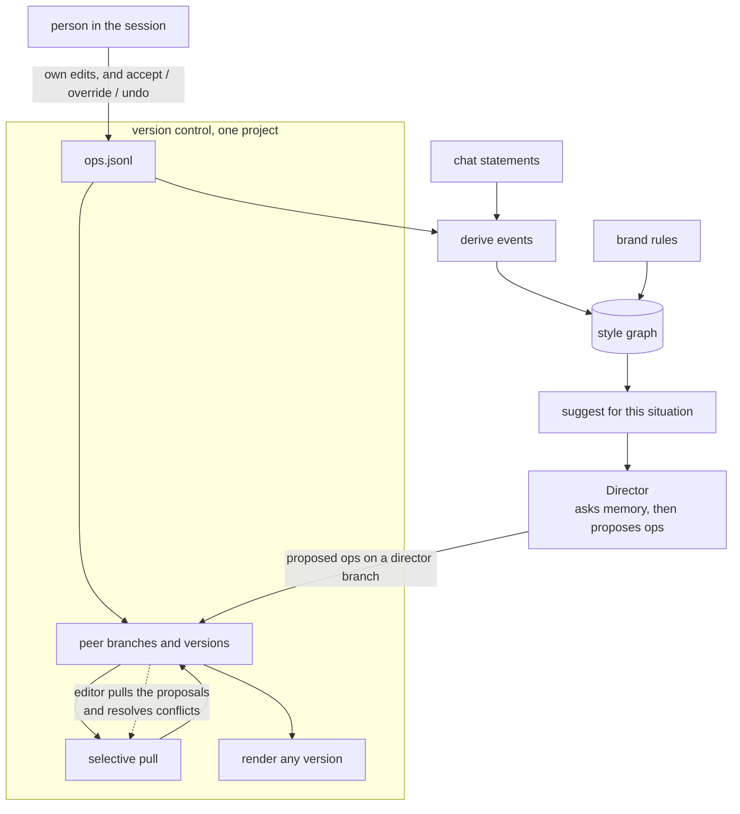

# Architecture

The proposal is the method. A video project is a content-addressed timeline history with no main branch. A style memory is derived from that same history. The Director asks the memory before it proposes an edit, and the person's accept, override, or undo is the next entry in the history.

The world in `data/` is synthetic. It exists so the method can be walked through. It is not evidence about real editors.

## 1. Version control

One project is one video. The timeline JSON is the source of truth. Media files are referenced by sha256. A rendered mp4 is thrown away and rebuilt.

Branches are peers. `rough-cut` is the import. A session is a branch off some version, usually that import. Nothing is elected main. A pull copies selected ops onto the branch you are on and writes one new version there. The other branch stays where it was.

An op records `before` and `after`, the entities and time ranges it touches, and the situation (`footage_type`, `prev_edit`, `format`, `section`). Clip ids survive trims and moves. A split mints two new ids whose `lineage.origin` is the original clip, so a later conflict can still see that both sides edited the same shot.

Two ops conflict when they share an entity and disagree, or when their time ranges overlap on the same track. Clean ops apply on their own. A conflict waits for ours or theirs. Ours skips the incoming op. Theirs rebases that op onto the current values and applies it. The new version has one parent, plus `pulled_from`.

The UI and the CLI write to `vcs/.workspace/`. They do not modify `data/`.

## 2. Memory

Memory does not watch the picture. It reads the op log and the chat log, turns style-bearing rows into events, and folds those events into a temporal graph. One question to `suggest()` is: for this person, this project, and this situation, which action should the next edit be?

`derive_events.py` labels an op from its type and its review pointer. A Director op is `agent_edit`. An `accept` is `user_accept`. A user op with `replaces_op` is `user_override`. A `revert` is `undo`. Move, split, delete, volume, and text-copy produce no event.

The engine groups a decision's events and keeps the person's final action. An override weighs more than an accept. An accept that is later undone leaves no evidence. That evidence is written into the full context and into every broader context, under the scope the project was in.

Each slot has a slow weight, which is the memory, and a fast window, which notices a new habit. When a new action leads that window for two sessions that brought new evidence, the old preference is closed and a `SUPERSEDES` edge is written. A chat line from the person is strong evidence. A non-lead telling the team what to do is stored as a proposal and adds no weight. A brand-banned action is filtered out of the answer and recorded with `VIOLATES`.

`suggest()` walks from the specific situation toward broader ones, dropping the least informative key first. Below a confidence floor, or on a situation that was never seen, it abstains. In a team project the team preference is the answer and the private one is returned beside it as a conflict.

## 3. Version control and memory together

This is the loop the two demos are for. The op log is the only history. The graph is a reading of that history. The Director proposes from the graph. The person keeps, replaces, or undoes the proposal, and that review is the next op.

What is built today:

- The store, the diff, the pull, the renderer, and the UI.
- Deriving events from the op log and the chat log.
- The engine, the graph, `suggest()`, the API, and an agent that writes proposed ops as JSON.

What the method still needs, shown by the dashed pull above:

- Those proposed ops are not yet real ops. They have no `op_id` and no `before`, so the store cannot commit them.
- Committing them onto a `director/…` branch, and letting the person pull them with the existing ours/theirs dialog, is the missing adapter.
- Until that review lands in `ops.jsonl` and is derived again, the next morning's memory does not see whether the person kept the suggestion.
