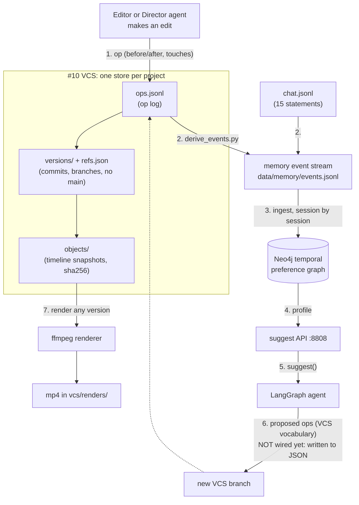
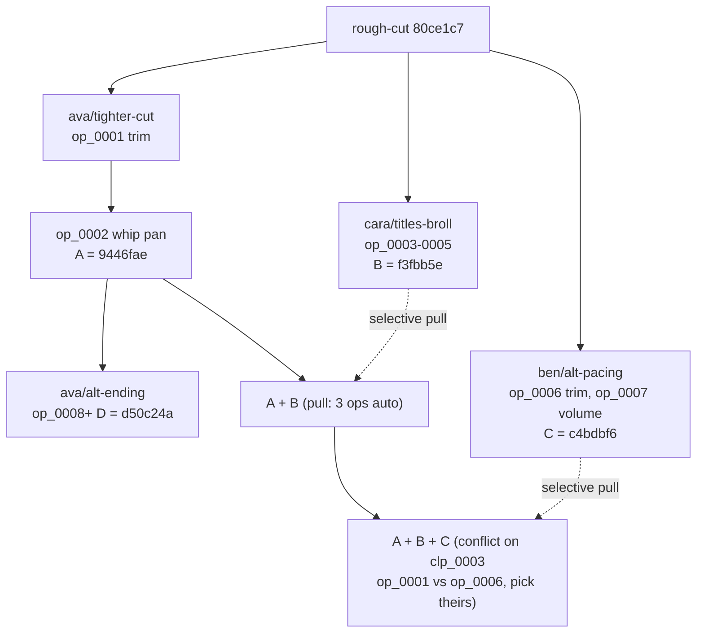
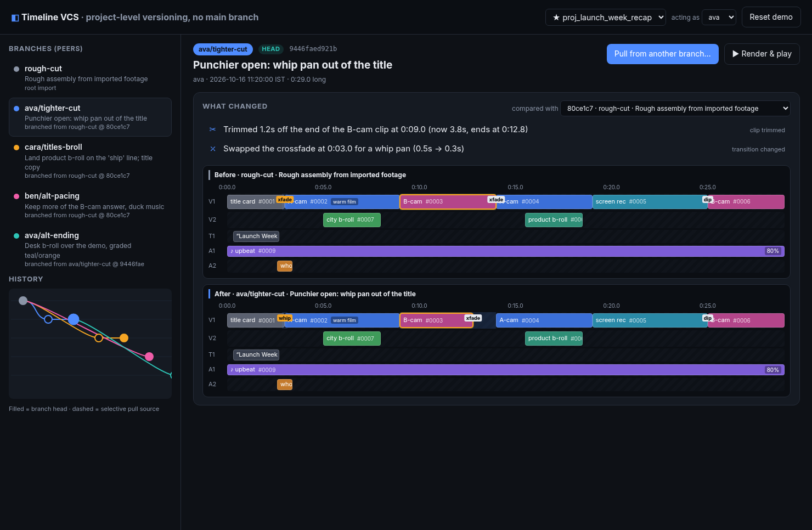
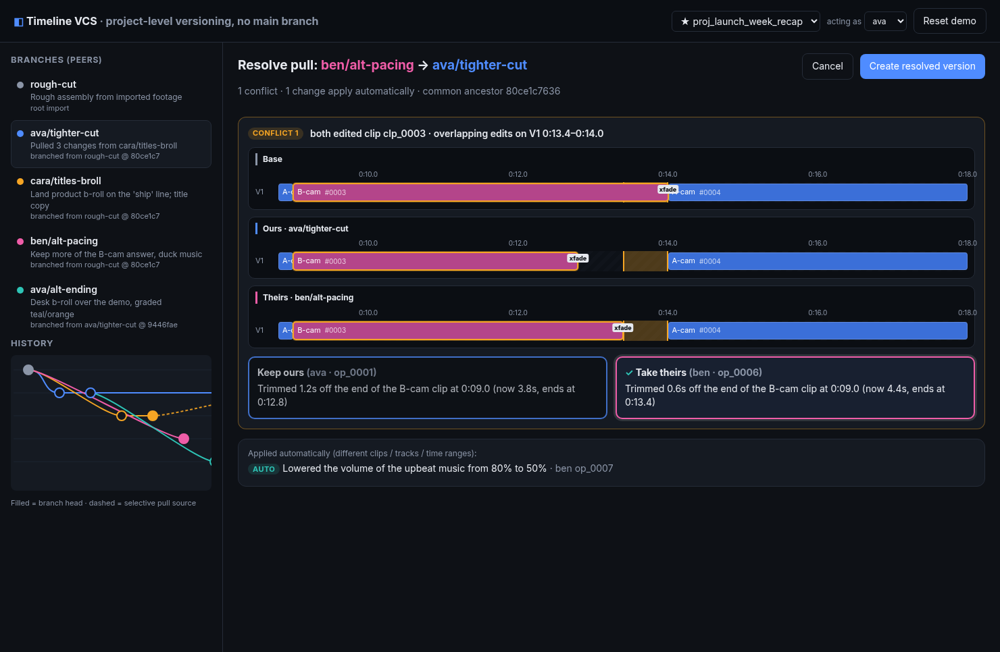
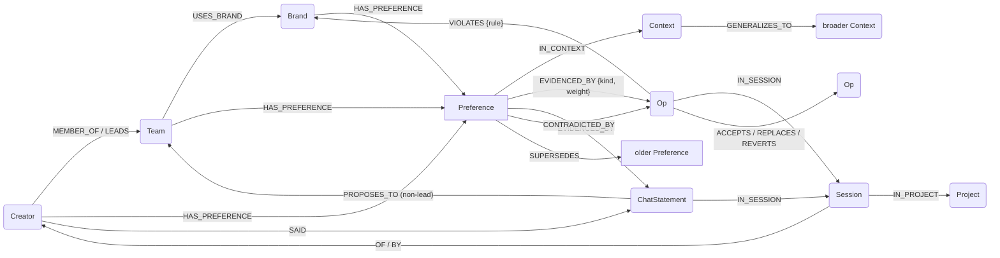
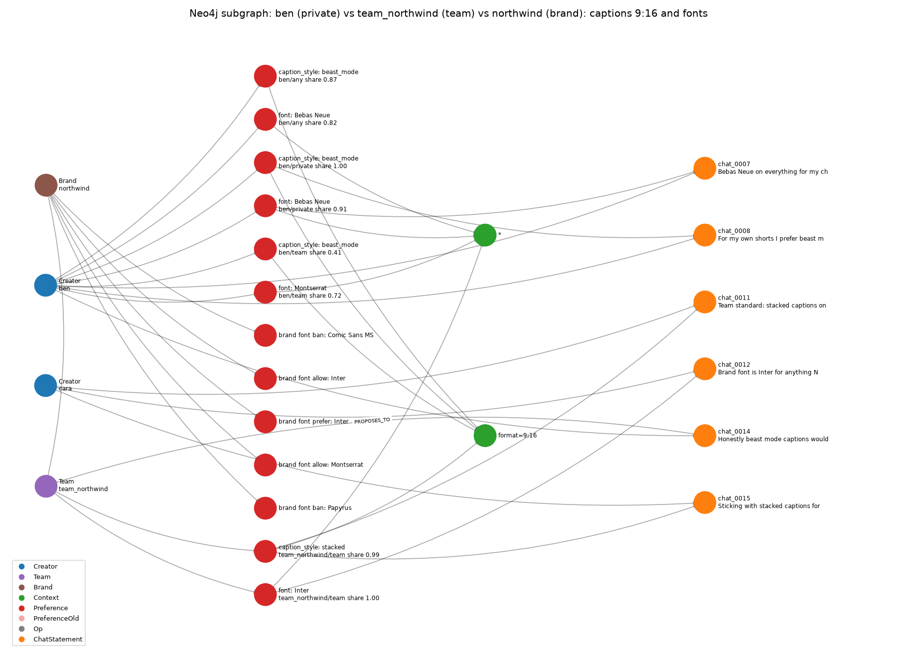

# cardboard_demo: a walkthrough

*Read this top to bottom for what every part of the repo does, why it was built that way, and how to run it. The proposal is the method in [ARCHITECTURE.md](ARCHITECTURE.md). The synthetic world is a worked example of that method.*

---

## 1. What this is, in three sentences

This repo holds two weekend demos for problems on [Cardboard](https://www.cardboard.ai)'s hard-problems list:

- **#10** is version control for video timelines (`vcs/`, TypeScript).
- **#8** is a memory that learns how each creator and team likes to edit (`memory/`, Python + Neo4j).

Both demos read one synthetic world (`data/`). In that world, every edit by a person or by the Director agent is an **op** in a per-project op log. That op log is the single input stream: the VCS stores it as history, and the memory derives its learning events from it. Nothing is generated twice.

---

## 2. End-to-end flow

<!-- png: diagrams/flow.png -->


1. **Someone edits.** A person or the Director agent changes the timeline, and the change is recorded as an op. The first op in the flagship project looks like this:
   - `type: trim_clip`, `payload.clip_id: clp_0003`
   - `before: {src_in 2.0, src_out 7.0, timeline_start 9.0}`, `after: {src_out 5.8}`
   - `touches: {entities: [clip:clp_0003, lineage:clp_0003], ranges: [V1 12.8–14.0]}`
   - plus the context (`footage_type, prev_edit, format, section`) and the author.

   A user's reaction to a Director edit is an op too. It can be an `accept` (`accepts_op`), an override (`replaces_op`) or a `revert` (`reverts_op`).
2. **The VCS stores it.** Each project has an append-only, content-addressed store. Applying the op produces a new timeline snapshot (`objects/<sha256>.json`) and a new version (`versions/<sha256>.json`, which points at its parent). The branch ref in `refs.json` then moves to the new version. The op is appended to `ops.jsonl`, carrying its `parent_version` and `result_version`.
3. **Events are derived.** `generators/derive_events.py` reads every `ops.jsonl` plus `data/world/chat.jsonl` and writes `data/memory/events.jsonl` (4,267 events, per `data/README.md`). The mapping is:
   - Director op → `agent_edit`
   - accept → `user_accept`
   - op with `replaces_op` → `user_override`
   - revert → `undo`
   - any other user op with a style category → `user_edit`
   - chat → `explicit_statement`

   Ops with no style category (move, split, delete, volume, text copy) produce no event. Every event points back to its `op_id` or `chat_id`.
4. **The memory ingests the events.** `memory/stylemem/ingest.py` replays the events session by session through `MemoryEngine`, which writes into Neo4j. Preferences open, gain or lose weight, and get superseded over time.
5. **Suggestions are served.** `uvicorn stylemem.api:app --port 8808` loads the preference profile from Neo4j. `POST /suggest` returns an action with confidence, reasons (`why[]`), source ops, conflicts, brand blocks, or an abstention.
6. **The agent proposes ops.** `stylemem/agent.py` is a LangGraph graph that asks `/suggest` once per slot of a cut and composes ops in the VCS vocabulary (`add_transition`, `add_effect`, `trim_clip`, `add_clip`, `add_text`). Each op carries its `memory.{action, confidence, why, source_events, conflicts, blocked}`.
   - **What is not built yet:** the arrow back into a VCS branch. Today the agent writes its ops to JSON (`memory/docs/results/agent_*.json`), and nothing commits them to a branch.
   - The proposed ops are also not complete VCS ops. They have no `op_id`, no `before`, and `trim_clip` carries a target duration instead of `src_out`. They would need a small adapter before `vcs` could apply them.
7. **Render path.** Any version, on any branch, can be rendered to mp4 by `vcs/core/render.ts`. The renderer turns the timeline JSON into one ffmpeg filtergraph. The mp4 is a disposable artifact; the timeline is the source of truth.

---

## 3. Architecture

Component diagrams for the VCS, the memory, and the two together are in [ARCHITECTURE.md](ARCHITECTURE.md). The picture below is the flagship project's branch story. The memory picture further down is the graph schema.

### 3.1 VCS (`vcs/`, TypeScript)

<!-- png: diagrams/vcs.png -->


**Store format.** There is one store per project, under `data/vcs/projects/<pid>/`:

- **`store/objects/<sha256>.json`** holds a timeline snapshot as canonical JSON (keys sorted, no spaces, UTF-8). The file name is the sha256 of the file's bytes, so identical timelines are stored once.
- **`store/versions/<sha256>.json`** holds the version metadata: `project_id, timeline_hash, parents, branch, author, timestamp, message, op_ids, session_id`. A version made by a pull also has `pulled_from`. The version id is the hash of this metadata.
- **`store/refs.json`** maps each branch name to `{head, created_from, created_by, created_at}`. It includes the note "No main: every branch is a peer."
- **`ops.jsonl`** is the append-only op log.

`vcs/core/canonical.ts` reproduces Python's `json.dumps(sort_keys=True, separators=(",",":"))` byte for byte, including printing whole-number floats as `3.0`. As a result, the TypeScript code reads and writes exactly the same hashes as `generators/vcs_store.py`. A test checks this on all 36 projects.

**Clip identity and lineage.** Clip ids (`clp_0003`) are stable across versions. When a clip is split, the two pieces get new ids, and each piece has `lineage = {origin, parent, created_by_op}`. The diff can then say "split the B-cam clip at 0:27.0", and the conflict check can follow a clip across splits: every op touches both `clip:<id>` and `lineage:<origin>`.

**Semantic diff** (`core/diff.ts`). Given two timelines, the diff matches clips by id and lineage, then emits structured items: `kind, entity, track_id, range, before, after, sentence`. It covers:

- trim (by how much, which edge), move, split, delete, add clip;
- transition add and change;
- text add, edit and style;
- effect add and update;
- volume, music replace, and track added.

Each item comes with a sentence written the way an editor would say it, using friendly asset names (for example "B-cam" rather than `asset_cam_b`).

**Selective pull and conflict rules** (`core/pull.ts`). There is no merge, because blending two finished cuts is not something an editor wants. Instead you **pull** ops from another branch:

1. Find the common ancestor. You can pull everything the source branch did since then, or choose individual ops (cherry-pick).
2. Each incoming op is compared with each op the target branch made since the ancestor. A pair **conflicts** if any of these holds:
   - they touch the same entity (clip, or its lineage, or a transition or text layer) and produce a different `after`;
   - they touch overlapping time ranges on the same track;
   - the incoming op's precondition no longer holds;
   - applying it would make clips overlap on a track. This last check is defence in depth.
3. Ops that don't conflict apply automatically. Ops that do conflict wait for a choice. **Ours** skips the incoming op. **Theirs** rebases the op's `before` onto the current values and then applies its `after`.
4. The result is a **new version on the target branch**. It has a single parent plus `pulled_from: {branch, version}`. Each copied op gets `pulled_from_op`, so a later pull skips ops that were already brought over.

The four expected results that the generator planted are reproduced exactly, timeline hash included:

- B→A is clean.
- C→A conflicts: op_0001 vs op_0006, both trimming `clp_0003`, with overlapping time on V1 at 13.4–14.0. op_0007 (the volume change) applies automatically.
- B→D is clean.
- C→B is clean.

**Render** (`core/render.ts`). The whole timeline becomes one ffmpeg filtergraph:

- **V1** is a sequence. Gaps become black. Neighbouring clips are joined with `concat`, or with `xfade` when the timeline has a transition between them.
- **V2** clips are overlays enabled for their time window.
- **Text** layers use `drawtext`.
- **Colour grades** map to `colorbalance`/`eq`.
- **Audio** clips are trimmed, delayed and mixed with their volume.

Output is 640×360 at 30 fps. `renderCached` stores results by timeline hash.

**API and web UI.**

- **The server.** `server/index.ts` is a Fastify server on :4310. Its main endpoints are:
  - `/api/projects`
  - `/api/p/:pid/state`
  - `/api/p/:pid/version/:ref`
  - `/api/p/:pid/diff`
  - `/api/p/:pid/pull/plan`
  - `POST /api/p/:pid/pull`
  - `POST /api/p/:pid/render`
  - `POST /api/p/:pid/reset`
- **The UI.** `web/` is a React + Vite app with:
  - a project picker;
  - the branches listed as peers, plus a lane graph where pulls show as dashed edges;
  - before/after timeline strips;
  - the diff sentences;
  - a pull dialog where each op is tagged AUTO or CONFLICT;
  - a conflict view with base, ours and theirs strips and click-to-pick cards;
  - a render-and-play panel.
- **Where writes go.** All writes go to a working copy at `vcs/.workspace/`, so `data/` is never changed.

**Design decisions and why.**

- **The timeline is the source of truth, and the mp4 is disposable.** Diffs, pulls and conflicts are about edit decisions, which live in the timeline. Pixels can always be re-rendered from it.
- **There is no main branch.** In a team edit, nobody's cut is "the" cut. Ava, Cara and Ben each branch from a version and pull what they want from each other. A canonical branch would force a merge-into-main workflow that doesn't fit video.
- **Selective pull instead of merge.** You can't sensibly blend two different trims of the same clip; someone has to pick. Pulling individual ops keeps every result explainable ("took Ben's trim, kept my whip pan").
- **Content addressing and append-only storage.** Every version stays reachable and identical timelines dedupe for free. Branching from any old version is just a new ref.
- **Ops carry `touches`.** The conflict check only needs to compare entity sets and time ranges. It never has to diff whole timelines.





### 3.2 Memory (`memory/`, Python + Neo4j)

<!-- png: diagrams/memory.png -->


**Graph schema** (`stylemem/graph.py`).

Nodes:

- `Creator` (role, bio)
- `Team` (lead)
- `Brand` (name, version, hard_constraints, palette)
- `Context` (key, specificity)
- `Preference`, with these properties:
  - `pref_id, owner, category, action, scope, observed_in, context_key`
  - `valid_from` / `valid_to` and their session ids
  - `share, decayed_weight, support_count, status (active|superseded)`
  - `origin, reason`
- `Op` (the VCS op's fields)
- `Session`
- `ChatStatement`
- `Project` (scope, brand_id)

Edges:

- `HAS_PREFERENCE` and `IN_CONTEXT`
- `EVIDENCED_BY {kind, weight, ts}` and `CONTRADICTED_BY`, which point to the exact ops and chat lines
- `SUPERSEDES {session_id, ts, reason}`
- `GENERALIZES_TO` (the context lattice)
- `MEMBER_OF` / `LEADS` / `USES_BRAND`
- `IN_SESSION` / `IN_PROJECT` / `OF` / `BY` / `SAID`
- `ACCEPTS` / `REPLACES` / `REVERTS` between ops
- `VIOLATES {rule}` from an op to the brand
- `PROPOSES_TO` from a non-lead's "the team should…" statement to the team

**Streaming ingestion.** Events are processed one session at a time, in timestamp order. Implicit evidence (edits, accepts, overrides, undos) is aggregated per session. Explicit statements and brand-violating ops take effect immediately. You can watch the graph grow live (`--step`, `--delay`), and a growth snapshot is saved after each session.

**Evidence weights** (`GET /health` params): override or edit 1.0, accept 0.7, reject 0.5 (applied against the action), explicit statement 3.0. An accept that is later undone counts as nothing.

**Contexts and backoff.**

- A preference lives in a slot keyed by (owner, scope pool, category, context). The context is a subset of `footage_type, prev_edit, format, section`.
- When asked, the search goes from the most specific context to broader ones, down to `*` (any context). Keys are dropped least-informative first, by mutual information computed from the graph's counts.
- A narrower slot is skipped as **stale** when a broader context has already superseded its action since the narrower slot last saw evidence. The `why[]` field reports this, for example "2 narrower context(s) skipped as stale…".

**Decay and supersession.**

- Each slot keeps two things:
  - slow weights, which give share and confidence;
  - a fast window with a half-life of 3 sessions, which works as a change detector.
- A challenger supersedes the current action when it leads the fast window with ≥60% share in **2 consecutive sessions with new evidence**.
- Supersession closes the old preference (sets `valid_to`) and opens a new one, linked by `SUPERSEDES`. The slow weights then restart from the fast window, so the old style doesn't linger.
- An explicit statement for a different action supersedes immediately.
- The selected parameters use effectively no slow decay (`half_life_sessions: 1000000000.0`). Change detection does the forgetting instead. This was chosen on train data.

**Scoping rules.**

1. **Brand hard constraints always win.** They act as a filter: a blocked action is reported in `blocked[]` with the rule that blocked it.
2. **Private projects:** the creator's private preference beats the team's ("private > team").
3. **Team projects:** the team standard applies. The creator's private preference is returned in `conflicts[]` with both sides' source ops and any chat citations. It is never silently dropped.
4. **Team standards come only from the team lead's statements and from behaviour in team projects.** A non-lead saying "the team should…" is stored as a proposal (`PROPOSES_TO`) with no weight.

**Confidence and abstaining.** Confidence is the Wilson lower bound on share, with n equal to the decayed support and z = 1.28. That's why three out of three gives 0.62, not 100%. The system abstains (`abstain: true`, with `best_guess` still reported) in two cases:

- confidence is below 0.5;
- no key of the context was ever observed for that owner and category.

**Where the LLM fits, and the rule-based fallback.**

- **Structured ops never go through an LLM.** They map to graph evidence deterministically, because they are already structured: an LLM would only add cost, latency and errors.
- **The LLM is used only for the 15 free-text chat statements** (`stylemem/extract.py`). It must return JSON in a fixed schema:
  - `is_preference, kind, target, category, action, polarity`
  - `context, scope_hint, avoid_actions, rationale`

  The output is then checked against the vocabulary.
- **Without an API key** (xAI, OpenAI or Anthropic), a hand-written lexicon extractor runs instead. Its output is labelled `rule_based_fallback` everywhere. **All committed results used the fallback.**

**API** (FastAPI, :8808):

- `POST /suggest`, which also supports a list over all categories;
- `GET /check?category&action&brand_id`;
- `GET /stats`;
- `GET /preferences/history?owner&category&context_key`, the temporal history of a slot;
- `POST /reload`;
- `GET /health`.

**Agent** (`stylemem/agent.py`, LangGraph). The steps are `plan_slots → query_memory → brand_gate → compose_ops → (llm_note)`.

- **plan_slots** creates the lookups for a cut:
  - per clip: a transition (except the first clip), a colour grade and a cut length;
  - per section: a music mood;
  - one title font;
  - a caption style when the format is 9:16 or the brand requires captions.
- **brand_gate** adds brand notes, such as "captions required on 9:16" or a required logo.
- **compose_ops** turns each answer into an op. Each abstention becomes an `ask_user` item instead.
- It runs without an LLM: `llm_note` prints "(no LLM key in env: deterministic agent, no LLM note)".



---

## 4. Folder-by-folder map

```
cardboard_demo/
├── README.md                     top-level summary of both demos (status, headline results)
├── Makefile, scripts/generate_all.sh   regenerate data/ (media → world → derive → validate)
├── docs/
│   ├── WALKTHROUGH.md / .docx    this document
│   ├── diagrams/*.mmd, *.png     mermaid sources + rendered PNGs (mermaid-cli)
│   └── build_docx.sh             md → docx (swaps mermaid blocks for PNGs, runs pandoc)
├── generators/                   Python that WRITES data/ (run via make); nothing else writes data/
│   ├── world_spec.py             cast, brand, vocab, planted rules/drift/statements/violations (pure data)
│   ├── gen_media.py              11 tiny labelled test clips + manifest with sha256
│   ├── timeline_ops.py           op semantics: apply op → new timeline (incl. accept/revert)
│   ├── vcs_store.py              content-addressed store, op construction, touches, conflict rule
│   ├── flagship.py               scripted proj_launch_week_recap + expected pull results
│   ├── gen_world.py              all 36 projects, 106 sessions, ops, chat, ground truth
│   ├── derive_events.py          op logs + chat → memory events / labelled decisions / splits
│   └── validate.py, minischema.py   integrity, cross-links, replay checks
├── data/                         synthetic world; READ by vcs/ and memory/, never written by them
│   ├── media/                    files/ + manifest.json; read by the renderer
│   ├── world/                    cast, brand_guidelines, vocab, sessions (106), chat (15), planted_labels (generator-only)
│   ├── vcs/                      schema.md, timeline.schema.json
│   │   └── projects/<pid>/       project.json, ops.jsonl (THE shared input stream), store/{objects,versions,refs.json}
│   │       └── proj_launch_week_recap/   + scenario.json, base_timeline.json, heads/, expected/ (pull answers for tests)
│   └── memory/                   events.jsonl, decisions_labeled.jsonl, splits/ (all DERIVED), ground_truth.json (grading only)
├── vcs/                          demo #10 (TypeScript); writes only to vcs/.workspace and vcs/renders
│   ├── core/                     store.ts, canonical.ts, ops.ts, touches.ts, diff.ts, pull.ts, render.ts, types.ts, paths.ts
│   ├── cli/index.ts              `npm run vcs -- log|diff|pull|resolve|render|branch|checkout|reset`
│   ├── server/index.ts           Fastify API + serves web/dist on :4310
│   ├── web/                      React/Vite UI (App, Strip, Graph, PullDialog, ConflictView)
│   ├── test/                     vitest: store compat, flagship pulls, conflict/resolve, diff sentences
│   ├── scripts/demo.ts           renders renders/demo/01..05 + renders.json
│   ├── scripts/screenshots.ts    headless Chrome → docs/screenshots/
│   ├── renders/demo/             committed mp4s (base, A, B, A+B, resolved)
│   ├── docs/screenshots/         7 UI screenshots
│   └── .workspace/ (ignored)     working copy of data/vcs/projects the CLI/UI mutate
└── memory/                       demo #8 (Python); reads data/, writes Neo4j + memory/docs/
    ├── stylemem/
    │   ├── config.py             paths, default parameters
    │   ├── data.py               read-only loaders for data/ (events, ops index, cast, brand, vocab)
    │   ├── engine.py             MemoryEngine: evidence, slots, fast/slow weights, supersession
    │   ├── context.py            context keys, subsets, lattice parents
    │   ├── extract.py            chat statement extraction: LLMExtractor + rule_based_fallback
    │   ├── brand.py              brand hard constraints (filter, /check)
    │   ├── graph.py              Neo4j schema, writes, load_profile(), snapshots
    │   ├── profile.py            engine-backed and Neo4j-backed profiles (same interface)
    │   ├── suggest.py            backoff/staleness, scoping, Wilson confidence, abstain, conflicts
    │   ├── ingest.py             streaming replay into Neo4j
    │   ├── api.py                FastAPI on :8808
    │   ├── agent.py              LangGraph agent → proposed ops
    │   ├── evaluate.py           held-out eval, baselines, ablations, train-only grid search
    │   ├── demos.py, plots.py    demo JSONs and PNGs
    ├── tests/                    pytest (16): scoping, supersession, abstain, extraction, engine == Neo4j
    └── docs/                     *.png plots; results/*.json (eval, demos, agent outputs, engine-vs-Neo4j check)
```

---

## 5. How to run everything from scratch

**Prerequisites:**

- Python 3.10+
- ffmpeg/ffprobe with `drawtext` and `xfade` (tested with 7.1)
- Node 20+
- Neo4j 5 (Java 17+) on `bolt://localhost:7687`, user `neo4j`, password `cardboard-demo`. Override with `NEO4J_URI / NEO4J_USER / NEO4J_PASSWORD`.
- For the screenshots only: Chrome at `/usr/bin/google-chrome`.

```bash
# 0. data (optional: data/ is committed)
make data                     # media → world → derive → validate

# 1. VCS (#10)
cd vcs && npm i
npm test                      # 22 vitest tests
npm run demo                  # renders/demo/01..05.mp4
npm start                     # build UI + serve UI/API on http://localhost:4310
npm run screenshots           # optional, with the server running
npm run vcs -- diff rough-cut ava/tighter-cut

# 2. Memory (#8)
cd ../memory
python -m venv .venv && . .venv/bin/activate && pip install -r requirements.txt
python -m stylemem.ingest --reset          # full history → Neo4j
python -m stylemem.demos                   # example suggestions → docs/results/demo_*.json
pytest -q tests                            # 16 tests
uvicorn stylemem.api:app --port 8808
python -m stylemem.agent --api http://localhost:8808 --project proj_team_northwind_11 --actor ben
```

### 60-second demo: #10 timeline VCS

1. Open http://localhost:4310 and click **Reset demo**. Point out that the branches are listed as peers and there is no main.
2. Click **ava/tighter-cut** and compare it with `rough-cut`. You'll see two sentences: the 1.2s trim and the crossfade → whip pan. The changed clip is highlighted in the before/after strips.
3. Optionally click **ava/alt-ending** to show split lineage ("Split the B-cam clip … at 0:27.0").
4. Click **Pull from another branch…** and choose `cara/titles-broll`. All three ops are AUTO. Click **Pull 3 changes**. The result is a new version on ava's branch, and a dashed pull edge appears in the graph.
5. Pull from `ben/alt-pacing`. The conflict view opens: same clip, overlap on V1 at 13.4–14.0, with base, ours and theirs strips. The volume change is applied automatically.
6. Click **Take theirs**, then **Create resolved version**. The diff now reads "Extended … by 0.6s" plus the volume change.
7. Click **Render & play**.

### 60-second demo: #8 style memory

1. **Graph growing.** Run `python -m stylemem.ingest --reset --step --delay 0.3` and watch Neo4j Browser (:7474) with `MATCH (p:Preference) RETURN count(p)`, or show `memory/docs/graph_growth.png`.
2. **Drift.** Run `curl -s 'localhost:8808/preferences/history?owner=ava&category=transition&context_key=footage_type%3Dtalking_head%7Cprev_edit%3Djump_cut'`. Crossfade closes at ava_s23 and whip_pan opens. Then show `drift_timeline.png`: b-roll stays crossfade.
3. **Team conflict.** Ask `/suggest` for ben's `caption_style` at `{talking_head, jump_cut, 9:16, hook}`:
   - in a team project, it returns `stacked`, with beast_mode in `conflicts[]` citing chat_0014;
   - in a private project, it returns `beast_mode`.
4. **Brand.** Ask for ben's `font` with `brand_id=northwind`. It returns Montserrat, with Bebas Neue in `blocked[]`. Then `/check` shows that glitch is banned.
5. **Abstain and agent.** An unseen context (drone / aerial_reveal / 4:5) returns `abstain: true`. Then run the agent and show one op with its `why[]` and `conflicts[]`.

---

## 6. What this is not

The proposal is the method in [ARCHITECTURE.md](ARCHITECTURE.md). The files under `memory/docs/results/` are a local replay of the planted rules. They are not a measurement of the method, and this walkthrough does not quote them.

`python -m stylemem.evaluate` checks that the engine follows the rules in `generators/world_spec.py` on a held-out slice of the same synthetic world. The answer key was written by that generator. A match means the graph noticed a pattern the generator had been repeating.

---

## 7. Known gaps and next steps

**Gaps:**

1. **The loop isn't closed.** The agent's proposed ops aren't committed to a VCS branch. They are op-shaped JSON with no `op_id` or `before`, and `trim_clip` gives a target duration.
   - *Next:* add an adapter in `vcs/core` that turns them into real ops on a new `director/<actor>-suggestions` branch. The editor could then cherry-pick them with the existing pull dialog, and accepting or reverting them would feed back into memory as new events.
2. **Memory reads only `data/`.** Edits made in the VCS UI (in `vcs/.workspace`) don't reach memory until `derive_events.py` runs over them.
   - *Next:* have the VCS emit events on commit and have ingest consume them incrementally.
3. **VCS:**
   - pulls create single-parent versions (with a `pulled_from` field) rather than merge commits;
   - "theirs" replaces the whole op; there is no field-level three-way merge inside one clip;
   - there is no ripple editing, no auth or locking, and no multi-user server.
4. **Renderer:** no format/aspect handling, no text animation, and approximate transitions.
5. **Memory:**
   - confidence calibration (for example isotonic regression on online predictions);
   - a real-LLM run of `extract.py` with error analysis;
   - richer context than 4 keys;
   - fixing the own-project team-scope case.
6. **A check on real edits.** The engine has only been run on this planted world.
7. **Housekeeping:** a stray empty file `memory/=1.11` (probably a mistyped `pip install x>=1.11`) can be deleted.
